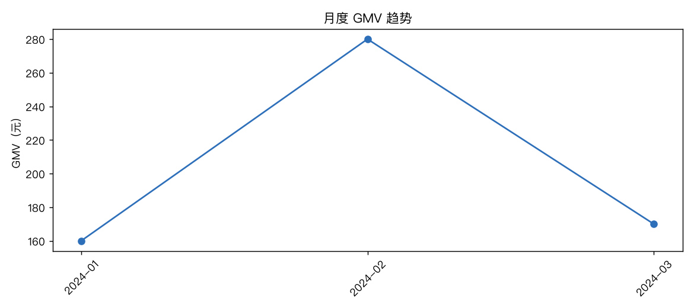
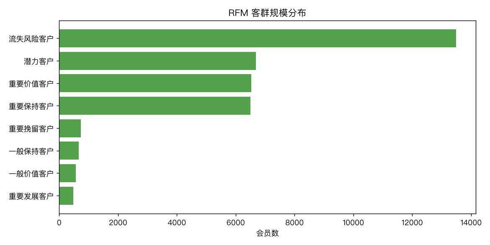
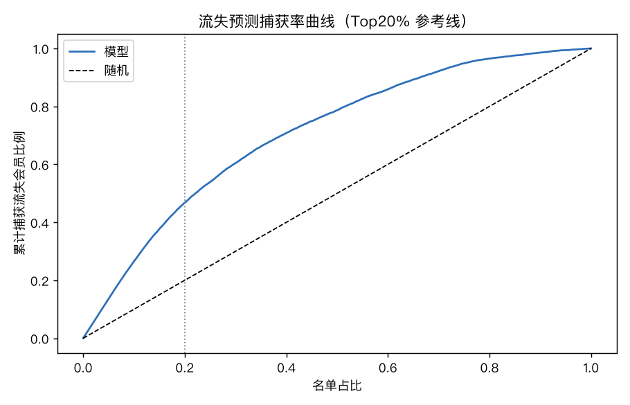
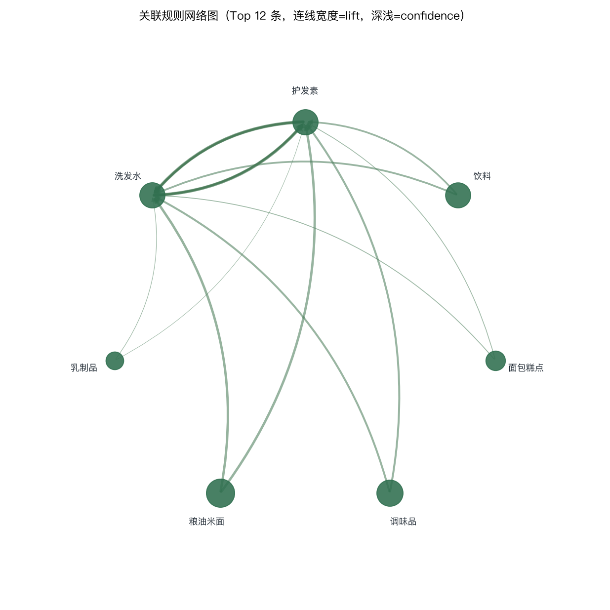

<div align="center">

# RetailInsight

**连锁商超会员画像与决策支持系统**

从合成数据生成、清洗，到 RFM 分群、K-Means 聚类、流失预测、关联规则，<br>
最终产出**含量化测算**的门店级运营与采购建议。


<br><br>



<sub>月度 GMV 与季节性双峰：峰值月 2021-12（315.4 万元）为淡季基准（24.7 万元）的 <b>12.8 倍</b></sub>

</div>

---

## 数据概览

| 维度 | 规模 |
| --- | --- |
| 会员 | 36,000（注册口径），其中 17,937 人有重复购买 |
| 门店 / SKU | 15 家 / 5,000 |
| 交易 / 明细 | 315,139 → 清洗后 313,571 笔 / 2,174,049 行 |
| 有效分析窗口 | 2020-01 ~ 2022-07，共 31 个月、308,956 笔有效交易 |

## 核心结果

### 分群：价值高度集中

| 指标 | 结果 |
| --- | --- |
| RFM 8 类客群 | 重要价值客户 6,531 人（18.3%）贡献 **42.5% GMV**，人均净消费 2,784.4 元；叠加次大客群后 36.6% 会员贡献 77.8% GMV |
| 风险侧 | 流失风险客户 13,485 人（37.8%），平均 **305 天**未消费，仅贡献 9.8% GMV；模型标记高危会员 5,014 人 |
| 会员漏斗 | 注册→首购 99.0%，首购→复购 71.5%，复购→高频 39.2%；「有复购未达高频」的 15,494 人是最大可运营池 |
| K-Means 聚类 | 4 簇（高价值活跃 / 一般维持 / 低频低额 / 沉睡流失），轮廓系数 **0.4165**（验收线 0.35） |
| CLV 分层 | 4 档，主口径 **BG/NBD + Gamma-Gamma**（未来 12 个月期望毛利） |

### 预测：模型与验证

| 指标 | 结果 |
| --- | --- |
| 流失模型 | **RandomForest AUC 0.830**，较 LR 基线 0.7995 **+0.0305 达标** |
| 排序能力 | 标准 KS **0.4936**；Top20% 名单捕获 **46.77%** 真实流失者（lift 2.34，理论上限 2.72 的 86%） |
| GBDT 对照 | LightGBM AUC 0.8179（增益 +0.0184 未达标）—— 经 6 组敏感性实验确认为当前数据窗口的天花板 |
| CLV 回测 | 91 天时间外：金额 MAE **229.3 vs 270.8（降 15.3%）**，偏差从 +74.4 元压到 **−1.4 元** |
| 聚类选型 | K-Means 0.4165 / GMM 0.2536（碎群 0.7%）/ DBSCAN 0.0422（噪声 5.2%）→ 结论由规则化准则给出 |

### 商品与关联

| 指标 | 结果 |
| --- | --- |
| 品类级规则 | **177 条**（lift>1.5），4 组预埋组合全部回收，最强 洗发水→护发素 lift **8.30**、火锅底料→牛羊肉 5.02 |
| SKU 级规则 | **48 条**，全为「单品 A → 单品 B」，lift 中位 46.4 |
| 分门店规则 | **1,092 条**，15 店全覆盖 |
| 品类集中度 | Top5 品类（饮料/乳制品/面包糕点/调味品/粮油米面）合计 63.1% GMV；A 类品类 6/60 |
| 时段特征 | 高峰 10/9/11 点，周末订单占比 29.7% |

### 工程

| 指标 | 结果 |
| --- | --- |
| 分块流式生成 | 20 万会员 / 1,200 万明细 **5.2s** 完成，峰值内存 ≈1.0GB、落盘 108MB |
| DuckDB 星型模型 | SQL 版 RFM 与 pandas 版 **35,650 行零差异** |
| 明细分区 | 按月分区，读最近 3 个月仅占全量 **20.2%** |
| 测试 | **200 个用例 / 覆盖率 82.78%**，含 Streamlit `AppTest` 看板端到端 |
| 看板 | Streamlit 4 页，plotly 点选下钻，首屏实测 **0.51s** |

### 交付物

Excel 报表（6 sheet）· **13 张分析图** · 决策建议报告（8 条建议全部含量化测算）· 客群画像卡片（8 群各一页）· 性能压测报告（scale 5）· 数据质量报告（md + json + 自包含 HTML）· 5 个**已执行**的 Notebook

---

## 图表

<table>
<tr>
<td width="50%"></td>
<td width="50%"></td>
</tr>
<tr>
<td align="center"><sub><b>RFM 8 类客群</b>：人数与 GMV 贡献的错位 —— <b>18.3% 的人撑起 42.5% 的生意</b></sub></td>
<td align="center"><sub><b>流失模型累计增益</b>：Top20% 名单覆盖 <b>46.77%</b> 真实流失者，lift 2.34</sub></td>
</tr>
</table>

<p align="center">
<br>
<sub><b>关联规则网络（品类级，lift&gt;1.5）</b>：4 组预埋组合全部回收、无一条漏检；最强规则「洗发水 → 护发素」lift 8.30、「火锅底料 → 牛羊肉」lift 5.02。规则不止是数字，落点是采购与陈列动作 —— 这也是报告里 S5/S6 两条建议的来源。</sub>
</p>

---

## 快速开始

```bash
# 1) 安装
python -m venv .venv && source .venv/bin/activate
make install                  # 等价于 pip install -e ".[dev]"

# 2) macOS 上若 lightgbm 报 libomp 缺失（会降级为 sklearn HistGB，指标略低）
python scripts/fix_lightgbm_dylib.py

# 3) 一键跑通全链路（14 个 stage，约 2.5 分钟）
make all
# 或：python -m retailinsight.cli run --stage all --scale 0.3
# stage：gen etl rfm cluster rules rules_sku rules_store churn
#        profile warehouse reports report cards segment_compare
#       （dashboard = 交互式看板，不进 all，单独跑）

# 4) 测试（覆盖率门禁 ≥60%）
make test                     # 200 个用例
make cov                      # 覆盖率明细

# 5) 看板
make dashboard                # = streamlit run dashboard/app.py

# 6) 分析 Notebook（5 个，均已执行并保存输出）
python scripts/build_notebooks.py && jupyter lab notebooks/

# 7) 大规模生成 / 性能压测
python -m retailinsight.cli run --stage gen --members 200000 --chunk-size 20000
python scripts/exp_scale5.py --scale 5
```

> 全链路必需的 `duckdb` / `plotly` / `shap` 已在**主依赖**里（v3.4 修复漏声明）；`lightgbm` 仍是可选，不装会自动降级为 sklearn HistGB，并在 `metrics_churn.json` 的 `backend` 字段留痕。

## 数据说明（合规）

- 全部数据由 `scripts/generate_synthetic.py` 算法生成，**不含任何真实个人信息**；canonical 列名由生成器**直接产出**，不再经过任何外部源列名映射层（该映射层与下载器已于 v3.5 整体删除，理由见 `docs/项目编写计划.md` §0.13）
- 生成器支持**分块流式生成**：`chunk_size=0` 走原路径，产物与历史基线**字节级一致**
- **原始数据范围 2010-01-01 ~ 2022-07-31**：其中 1,511 行是生成器故意注入的「时间乱序」脏数据（全部标记 `is_logic_error=True` 并被剔除）；**有效分析窗口 2020-01-01 ~ 2022-07-31**
- 合成数据**已具备**门店级与人群级品类结构差异（v3.5 引入「城市档位 × 先验人群」品类乘子矩阵）：门店级差异度实测 **0.0502（最高 0.1244）**，落在真实商超 0.05~0.30 的**下沿**；规则法客群级差异度 0.0002~0.0095（受 ARI≈0.13 稀释）。因此 S8 门店差异化**方向可验证、量级偏保守**，客群级品类偏好仍只能算「弱差异」—— 两处口径与局限均已写入决策建议报告与客群画像卡片

## 已知限制

以下限制均已如实写入对应文档，不做粉饰：

- 流失模型在 **GBDT 口径**下增益 +0.019 打不到 +0.03 验收线（主模型已改选 RandomForest +0.0305 达标；GBDT 口径经 6 组敏感性实验确认是数据窗口的天花板）
- 聚类的 ARI 上限约 0.13：8 类先验人群中的「促销敏感 / 周末囤货 / 季节性」在消费体量上本质重合，需行为时序特征才能进一步区分
- 客群级品类偏好仍只有**弱差异**（差异度 0.0002~0.0095）：品类金额分布是 Zipf 长尾，头部品类会出现在所有客群 TOP3 里；门店级差异度 0.0502 已可支撑 S8 的**方向验证**，但绝对值仍需甲方真实门店-品类数据校准
- 41.4%（14,897 人）只买过一次的客户，CLV 走简化法兜底，均值仅 11.3 元，属于**已知低估**；注册未购（462 人）恒 0。逐行标记在 `clv_method`
- 聚类与流失模型在**合成数据**上评估，真实业务数据上的口径需重新校准
- `members.gender` 的 3.94% 缺失**不做填补**（保留「未知」为独立类别，猜性别比留空更危险）—— 已在质量报告第三节显式列出
- `ruff format --check` 未纳入门禁（`make lint` = `ruff check .`，当前全绿）

---

<div align="center">
<sub>决策建议报告见 <code>reports/决策建议报告.md</code> · 口径定义见 <code>docs/指标体系.md</code><br>
设计取舍与工程决策见 <code>docs/设计取舍与工程决策.md</code> · 计划与评审记录见 <code>docs/项目编写计划.md</code></sub>
</div>
