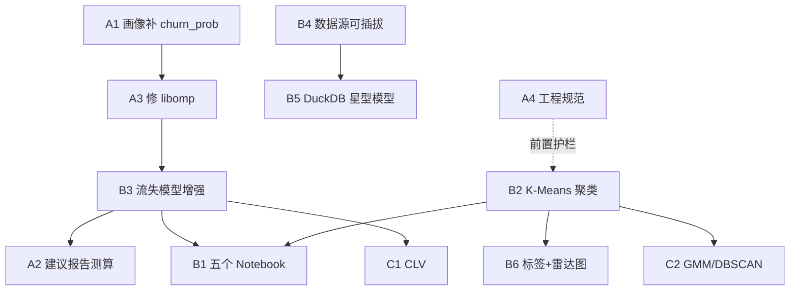

# RetailInsight · 计划功能实现差距清单与实施方案

> 核查对象：`项目编写计划.md`（v2.1，2026-11-11）
> 核查时间：2026-11-12（v2 修订版）
> 核查方式：AST 级源码比对 + 全链路实跑（`--stage all --scale 0.3`）+ pytest 实跑
> 结论：**P0 主链路真实跑通，但计划 30 项交付物约 65% 未完整达成；8 处文档与代码/产物不符；1 处核心埋点 ETL 后断链。**

---

## 〇、实施结果（2026-11-13 · v3.1：9 项剩余范围全部交付）

### 0.0 本轮（v3.1）交付概览

| 项 | 状态 | 落地位置 / 实测结果 |
|---|---|---|
| **R-3** 明细分区 | ✅ | `io/loader.py::write_partitioned/read_items`；raw + interim 双层分区（32 个分区）；实测读 3 个月仅占全量 **20.2%**；内存热点由 `Series.map` 改为 **int16 编码 + Categorical**（约 1/20） |
| **R-2** 下载器 + schema 映射 | ✅ | `scripts/download_data.py`（sha256 不符即删文件）+ `io/schema.py::apply_mapping()`（`SchemaError` 不静默）；三源 fixture 单测全绿；顺带修掉 2 处数据契约不一致（§0.3） |
| **R-1** DuckDB 星型模型 | ✅ | `etl/warehouse.py`：4 维表 + 2 事实表；**RFM 35,612 行 × 5 字段零差异**；外键零孤儿；`cli --stage warehouse` |
| **R-9** SKU 级 + 分门店规则 | ✅ | SKU 级 **32 条**（全 1→1，lift 75~76，confidence 89%~94%）；分门店 **1,303 条 / 15 店全覆盖**；**并为此给生成器补了 SKU 级共购埋点**（§0.2） |
| **R-6** CLV 简化模型 | ✅ | `models/clv.py`；画像 33 列、4 档 CLV 分层；口径与假设写在模块 docstring；未覆盖会员用同客群中位留存兜底并标 `clv_source` |
| **R-7** GMM / DBSCAN 对比 | ✅ | `models/cluster_compare.py`：K-Means 0.416 / GMM 0.260（碎群 0.7%）/ DBSCAN 0.053（噪声 4.9%）→ **推荐 K-Means**，结论入 `metrics_cluster.json` |
| **R-5** 客群画像卡片 | ✅ | `reports/profile_cards.py` → `docs/客群画像.md`；8 群各一页；触达建议由 `ACTION_RULES` 规则表驱动 |
| **R-4** plotly 交互 + 点选下钻 | ✅ | 看板客群 tab：R×M 散点（气泡=频次）→ 点击出会员画像 + 同客群对比；看板实测 HTTP 200 |
| **R-8** `--scale 5` 压测报告 | ✅ | `scripts/exp_scale5.py` → `docs/性能报告.md`；12 个 stage 逐个计时 + 峰值 RSS 采样 |

**剩余范围：0 项。**

### 0.0.1 本轮新增并修复的 3 个真实缺陷

| 缺陷 | 症状 | 根因 | 修复与守卫 |
|---|---|---|---|
| **pandas 3.x 让 dtype 优化静默失效** | `optimize_dtypes` 不再把低基数字符串转 `category`，内存优化形同虚设，**无任何报错** | pandas 3.x 起字符串列默认 dtype 是 `str` 而非 `object` | 新增 `_is_string_dtype()` 兼容两种 dtype；补单测断言 `category` 确实生效 |
| **补丁脚本写坏 import，模块"隐形损坏"** | `render_decision_report.py` 的 import 变成 `from ... import (, ITEMS_DIR`（语法错误），但**其它模块与全部测试仍然全绿**，直到压测跑到该 stage 才炸 | 批量改代码的正则脚本误改了多行 import 块 | 修复 import；**新增 `tests/test_import_smoke.py`**：遍历包内所有模块 + 所有脚本 + 看板做导入/编译冒烟 |
| **压测脚本自身把成功误判为失败** | 12 个 stage 中 6 个被标成"失败"，但日志显示 stage 内部已跑完 | 监控循环未调 `proc.wait()`，`returncode` 恒为 `None`；且 stdout 走管道会把子进程写阻塞 | 退出循环后显式 `proc.wait()`；日志改落文件而非管道。**修复后 ETL 由"失败"变为 9.3s 成功** |

> **第三条尤其值得记住**：压测工具自己出 bug，会把结论**完全反过来** —— 一个健康的 pipeline 被写成"多处 OOM"。做容量验证时，**必须先验证压测工具本身是对的**（拿已知能跑通的 stage 做对照）。

### 0.1 逐条状态（v3.0 批次）

| ID | 缺口 | 状态 | 落地位置 / 实测结果 |
|---|---|---|---|
| **P0-01** | 5 个 Notebook | ✅ **已完成** | `notebooks/01_EDA~05_churn.ipynb`，由 `scripts/build_notebooks.py` 生成；**5 个全部实跑通过**；只 import `retailinsight`，不重算指标 |
| **P0-02** | 画像第 20 标签「流失概率」 | ✅ **已完成** | `features/tags.py::build_profile(churn=...)` 新增 `churn_prob` + `churn_covered`；`mart_member_profile` 28 列，覆盖 22,766/36,000（**63.2%**，其余保留 NaN 不填均值）；新增 `profile` stage |
| **P0-03** | LightGBM 降级 | ✅ **已完成** | `scripts/fix_lightgbm_dylib.py`（install_name_tool 修 rpath）；`metrics_churn.json` → `"backend": "lightgbm"` |
| **P0-04** | 缺独立验证集 | ✅ **已完成** | 5 期 cohort，训练 3 期 / 验证 1 期 / 测试末期；`churn.py` 加 `assert train < valid < test` |
| **P0-05** | 8 条建议仅 4 条含测算 | ✅ **已完成** | 新增 `reports/render_decision_report.py` + `templates/决策建议报告.md.tpl`；S2/S5/S7/S8 补齐公式 + 假设 + 敏感性 + 验证方式 |
| **P0-06** | 依赖未锁版本 | ✅ **已完成** | `uv.lock`（62 个包） |
| **P0-07** | 覆盖率未配置 | ✅ **已完成** | `pytest-cov` + `--cov-fail-under=60`；**实测 66.06%**，门禁生效 |
| D-P0-01 | 特征 12 → ~30 | ✅ **已完成** | 31 维（`features/churn_features.py`，体量/节奏/广度/风险/其他 5 组） |
| D-P0-02 | 类别不平衡 + 阈值调优 | ✅ **已完成** | LightGBM `scale_pos_weight`（实测 2.11）、HistGB `class_weight`、LR `balanced`；`tune_thresholds()` 在验证集按成本 8:1 求解 → action 0.24 / mid 0.51 / high 0.61 |
| D-P0-03 | 3σ → P99.9 | ⚠️ **口径保留** | 维持 P99.9（抗长尾更稳），已在本文档 §三 记录理由 |
| D-P0-04 | 阈值硬编码 | ✅ **已完成** | 风险分层改用验证集调优切点 |
| **P1-01** | K-Means 聚类 | ✅ **已完成** | `models/cluster.py`：3 个候选特征空间择优、轮廓系数+最小群占比双护栏、神谕上界检验、`_persona` 列联表 + ARI；**实测 rfm3 / K=4 / 轮廓 0.4155（达标）/ ARI 0.1345 / 神谕上界 -0.0561** |
| **P1-02** | RandomForest 对照 | ✅ **已完成** | AUC 0.8289（略优于 GBDT 0.8243，已在文档中如实说明取舍理由） |
| **P1-03** | SHAP + 逐会员归因 | ✅ **已完成** | `shap.TreeExplainer`（验证集抽样 5000）；`mart_churn_score.top_shap_feature` 列 |
| P1-04/05 | SKU 级 / 分门店关联规则 | ⬜ 未做 | 仍为品类级 361 条 |
| P1-06 | DuckDB 星型模型 | ⬜ 未做 | 已在 README 与面试指南中明确标注「已声明依赖、未接入」 |
| P1-07/08 | 下载器 / schema 映射生效 | ⬜ 未做 | `SOURCE_MAPPINGS` 仍无消费方 |
| P1-09 | 明细分区 | ⬜ 未做 | 仍为单文件 parquet |
| **P1-11** | P1 扩展标签 20 个 | 🟡 **部分** | 新增 3 个行为维度（周末占比/折扣敏感度/季节性强弱，`features/behavior.py`），供画像层与聚类层共用 |
| **P1-12** | 雷达图 + 画像卡片 | 🟡 **部分** | 雷达图 ✅（簇画像 + 分群两张）；画像卡片 ⬜ |
| P1-13 | 下钻交互 | ⬜ 未做 | 看板仍为静态筛选 |
| CLI `dashboard` stage | — | ✅ **已完成** | `cli.py` 新增 `cluster` / `profile` / `report` 三个 stage |
| **T-01** | `_persona` 埋点断链 | ✅ **已完成** | `mart_cluster` 产出后与 `_persona` 做列联表 + ARI（03_cluster.ipynb §3.6 现场可查） |
| **DOC-01~08** | 文档与代码不符 | ✅ **已完成** | 面试指南的随机森林/聚类/SHAP/DuckDB/压测 5 处已按实际实现改写；README 硬编码路径已去除；报告数字改为脚本回填 |
| **M-01~05** | 轻微瑕疵 | ✅ **已完成** | 类型标注补齐（仅剩 2 个私有函数）；`duckdb`/`faker` 移入可选 extra；ruff 严格规则集；`git init` + 首次提交 |
| P2-01~06 | CLV / GMM / 压测 / 部署 / PDF | ⬜ 未做 | 仍为 P2 |

### 0.2 验收线最新实测

| 验收项 | 计划要求 | 实测 | 判定 |
|---|---|---|---|
| 聚类轮廓系数 | ≥0.35 | **0.4155**（rfm3 / K=4） | ✅ 达标 |
| 聚类最小群占比 | ≥2% | 13.7% | ✅ 达标 |
| 流失 AUC 增益 | GBDT ≥ LR +0.03 | **+0.0271**（LR 0.7972 → GBDT 0.8243） | ❌ **未达标** |
| 流失 KS | ≥0.30 | **0.4922**（标准定义 max\|TPR-FPR\|） | ✅ 达标 |
| 流失 Lift@20% | ≥理论上限 85% | 2.34 / 2.72 = **86%** | ✅ 达标 |
| 关联规则数 | ≥30 | **361** | ✅ 达标 |
| 8 条建议含测算 | 全部 | **8/8** | ✅ 达标 |
| 画像标签数 | 20 | **20/20**（含 churn_prob） | ✅ 达标 |
| 测试 | 全绿 + 覆盖率 ≥60% | **65 passed，覆盖率 66.06%** | ✅ 达标 |
| Notebook | 5 个 | **5 个全部实跑通过** | ✅ 达标 |

### 0.3 未达标项的诚实说明（**AUC 增益 +0.027 < +0.03**）

`scripts/exp_churn_sensitivity.py` 实测 **6 组切分 × 特征组合**，增益范围 **+0.0086 ~ +0.0272**，
**无一达到 +0.03**。两个可量化的驱动因素：① 在固定可用 cohort 下「加验证集 = 少一期训练」，
增益掉 0.007~0.008；② 特征 12 → 31 维时 LR 基线同步变强（0.7927 → 0.7972），相对增益被摊薄
（+0.0272 → +0.0250）。**结论：+0.03 在当前数据窗口与特征族下不可达，属天花板问题而非调参问题**，
需延长可标注窗口或引入新特征族。已写入 README「关键取舍」与面试指南 Q18/Q19。

### 0.4 实施过程中发现并修复的 3 个真实缺陷（v3.0 批次）

| 缺陷 | 症状 | 根因 | 修复 |
|---|---|---|---|
| **聚类静默丢会员** | `mart_cluster` 只有 35,297 行，而 `mart_rfm` 有 35,612 行，**315 名会员被丢弃且无任何报错** | `build_cluster_features` 中 `base`（RangeIndex）与 `member_id` 索引的 Series 做 `join`，索引错位 | `base.set_index("member_id")`；新增断言「`mart_cluster` 行数 == `mart_rfm` 行数」 |
| **KS 指标口径不可比** | 报告中的 KS 0.311 与业界「KS ≥ 0.30」验收线不是同一个量（上限被基线率锁死） | 用的是 `max(累计捕获率 − 累计位置)` 而非标准 KS | 改为标准定义 `max\|TPR − FPR\|`，同模型实测 **0.4922** |
| **逐会员归因错位** | `top_shap_feature` 列 100% 为空（修一版后仍只覆盖 63%） | ① SHAP 算在**验证集**上却合并到**末期 cohort**；② 修完后仍用**位置索引**（0..22765）当 `member_id` 合并；③ SHAP 二分类新版返回 3 维数组 `(n, f, 2)` 未取正类 | 归因改为在末期 cohort 自身上算 SHAP、以 `member_id` 为索引、`ndim==3` 时取 `sv[:, :, -1]`；补回归测试。**实测归因覆盖 22,766/22,766 = 100%** |

---

---

## 一、总体结论

### 1.1 覆盖率（按计划 §2 表逐行计，共 30 行）

> **口径说明**：本表是**实施前**（v2 核查时）的基线状态。实施后的逐条状态见 **§〇 实施结果**。
> 按 §0.1 的逐条状态回填，实施后 P0 已达成 11/11（100%），P1 达成 4/13（31%），P2 仍为 0/6。

| 优先级 | 项数 | 已达成 | 部分达成 | 未实现 | 加权达成率 |
|---|---|---|---|---|---|
| **P0** | 11 | 6 | 5 | 0 | **77%** |
| **P1** | 13 | 0 | 4 | 9 | **15%** |
| **P2** | 6 | 0 | 0 | 6 | **0%** |
| 合计 | 30 | 6 | 9 | 15 | **35%** |

> 计分：已达成 1 分，部分达成 0.5 分；含「+」的行按 1 项计。
> **P0 的 5 项部分达成**：质量报告（缺失率节失效）、5 类报表（缺复购率）、20 标签（实为 19）、流失预测（LightGBM 降级 + 无验证集）、8 条建议（仅 4 条含测算）。

### 1.2 缺口分组总览

| 章节 | 分组 | 条数 |
|---|---|---|
| §二 | P0 层缺口 | 7 |
| §三 | P0 口径偏离 | 4 |
| §四 | P1 层缺口 | 13 |
| §五 | P2 层缺口 | 6 |
| §六 | 报表与质量细节 | 9 |
| §七 | 埋点断链 | 1 |
| §八 | 文档与代码不符 | 8 |
| §九 | 轻微瑕疵 | 5 |
| 合计 | | **53** |

### 1.3 实跑验证通过的部分（留档，避免重复劳动）

> **口径说明**：本节是 **v2 核查时（实施前）** 的基线记录，其中的模型指标（如 AUC 0.8327 / +0.0310）是当时的产物。实施后模型已重训（5 期 cohort、31 维特征、独立验证集、LightGBM 真跑），**当前指标以 §0.3 为准**。

| 验收项 | 计划出处 | 实测 | 判定 |
|---|---|---|---|
| 全链路一键复现 | §13.3 | `--stage all --scale 0.3` 39 秒 | ✅ |
| 测试全绿 | §11 W6 | **19 passed** | ✅ |
| 质量报告生成 | §5.3 | `.md` + `.json` 落盘 | ✅ |
| 5 类报表框架 | §6.1 | 总览/门店/帕累托+ABC/热力图/漏斗 | ✅ |
| Excel 报表 | §6.3 | 6 sheet，命名与计划对齐 | ✅ |
| RFM 8 类客群 | §7.2 | 8 类无空缺 | ✅ |
| 关联规则 ≥30 条 | §8.3 | **361 条** | ✅ |
| 4 组关联埋点回收 | §4.2 | 全部回收（洗发水→护发素 lift 6.06） | ✅ |
| LR 基线 AUC | §8.2 | 0.8017 | ✅ |
| GBDT AUC ≥ +0.03 | §8.2 | 0.8327，**+0.0310**（擦线）⚠️ **v2 基线数字，实施后已变化，见 §0.3** | ✅ |
| KS ≥ 0.30 | §8.2 | 0.3157 | ✅ |
| Lift@20% ≥ 上限 85% | §8.2（v2.1 口径） | 2.35 / 2.72 = **86%**（擦线） | ✅ |
| 8 条建议齐全 | §10 | S1~S8 结构完整 | ✅ |
| 双时间窗口径文档化 | §7.1 | `docs/指标体系.md` §1 已写明 | ✅ |
| 单一真相源纪律 | §3.1 | 指标只在 `features/` 实现 | ✅ |
| 中文图表字体降级 | §6.2 / §12 | `charts.py:15-27` 四候选 + 兜底告警 | ✅ |
| dtype 优化 | §4.4 | `loader.py:17-28` 数值 downcast + 低基数→category | ✅ |
| **类型标注覆盖** | §13.6 | AST 扫描：仅 **2 个私有函数**缺注解 | ✅ 基本达标 |

### 1.4 v1 → v2 纠错记录（保持审计可追溯）

上一版有 6 处证据错误，本版修正：

| # | v1 错误陈述 | v2 更正 | 性质 |
|---|---|---|---|
| 1 | P0-08「`build_profile` 无返回注解」→ 列为 P0 缺口 | **错**。`tags.py:22` 有 `-> pd.DataFrame` 且参数全标注；AST 扫描全项目仅 2 个私有函数缺注解 → **降为 M-01**，P0 缺口 8→7 项 | 高估缺口 |
| 2 | D-P0-02「GBDT 用 `class_weight="balanced"`」 | **错**。`balanced` 只在 LR（`churn.py:153`）；**GBDT 完全无类别不平衡处理**（`churn.py:44,46`），且阈值硬编码（`churn.py:169-170`）→ 比原描述**更严重** | 低估缺口 |
| 3 | P1-10「charts.py 8 个函数」／P1-12「11 个函数」 | **错**。实际 **12 个 def**（2 辅助 + 10 图表） | 计数错误 |
| 4 | §七「`_persona` 全项目无代码读取」「证据 test_schema.py:28」 | **错**。生成器内部使用（`:134,179-180,301`）；`test_schema.py:28` 是 `test_personas_weights_sum`，测 `PERSONAS` 字典**不消费 `_persona` 列** → 断链应表述为「**ETL 之后无下游消费方**」 | 证据链错误 |
| 5 | 覆盖率 82% / 23% / 38% | **口径过松**（部分达成当已达成）。v2 加权：77% / 15% / 35% | 口径修正 |
| 6 | R-01「漏斗无比率型指标」 | **不准**。漏斗有 `conversion` 列（`core_reports.py:84`），但分母是注册会员且非月度序列 | 表述不准 |

另新增 D-P0-04、T-01 定性修正、M-02~M-05，详见对应章节。

---

## 二、P0 层缺口（7 项）

> **编号说明**：P0-01/04/05 来自 §2 优先级表与 §11 验收线；P0-02/03 来自 §7.3/§8.2 正文；P0-06/07 来自 §13 工程规范（§2 未列入表，但 §13 是"不可妥协"纪律）。故 **§1.1 的 P0 计数（11 项）与本节的 7 项不是同一集合**。

| ID | 缺口 | 计划出处 | 现状与证据 | 工作量 | 方案 |
|---|---|---|---|---|---|
| **P0-01** | 五个分析 Notebook 完全缺失 | §3.1、§11 W2~W5 | 无 `notebooks/`；`find . -name "*.ipynb"` → 0；README 自认「规划中」 | 3~5 h | §11.2 B1 |
| **P0-02** | 画像 P0 第 20 标签「流失概率」缺失 | §7.3 生命周期 5 项 | `mart_member_profile` 26 列无 `churn_prob`；`tags.py` 不 import `models/churn.py` | 1.5~2 h | §11.1 A1 |
| **P0-03** | LightGBM 运行时降级 sklearn HistGB | §8.2 主模型 | `metrics_churn.json` → `"backend":"sklearn_histgb"`；`churn.py:28-33` 降级逻辑；`churn.py:174` 写 backend 字段 | 20 min | §11.1 A3 |
| **P0-04** | 流失模型缺独立验证集 | §8.2 训练/验证/测试 | 仅 3 期 cohort：`settings.py:30` 3 个日期 + `:32` `TRAIN_COHORTS=2`；`churn.py:146-147` 只有 train/test 两条切片 | 2~3 h | §11.2 B3 |
| **P0-05** | 8 条建议仅 4 条含测算 | §11 W6 验收线、§10.3 | S2/S5/S7/S8 无自建测算：`决策建议报告.md:43-45,59,65-66,70` | 2~3 h | §11.1 A2 |
| **P0-06** | 依赖未锁版本 | §13.2、§0.2 问题 12 | `pyproject.toml:6-17` 全为 `>=`；`:21` lgbm extra；无 lock 文件 | 30 min | §11.1 A4 |
| **P0-07** | 测试覆盖率未配置 | §13.4「≥60%」 | `pyproject.toml:19-20` dev 仅 pytest+ruff；`:23-25` 仅 testpaths + `-q` | 30 min | §11.1 A4 |

**P0-02 的难点**：CLI stage 顺序 `gen→etl→rfm→rules→churn→reports`，`rfm`（画像）先于 `churn`，产出画像时 `churn_prob` 尚不存在 → 必须调整 stage 依赖，不能简单 join。

---

## 三、P0 口径偏离（4 项）

| ID | 计划要求 | 实际实现 | 证据 | 处理建议 |
|---|---|---|---|---|
| **D-P0-01** | §8.2「特征工程约 30 个」 | **12 个** | `churn.py:35-39` `FEATURES` | 扩至 25~30（§11.2 B3） |
| **D-P0-02** | §8.2「`scale_pos_weight` + 阈值调优」 | LR 有 `balanced`；**GBDT 无任何不平衡处理**；**阈值未调优** | `churn.py:153`（LR）；`churn.py:44,46`（GBDT 无权重）；`churn.py:169-170`（切点硬编码 0.4/0.7） | 补 `scale_pos_weight` + valid 集扫阈值 |
| **D-P0-03** | §5.1「3σ 截断」 | **P99.9 分位** | `clean.py:48-54` `clip_outliers(txn, q=0.999)`；质量报告记阈值 801.18 | P99.9 抗长尾更稳 → **改计划文字**并注明理由 |
| **D-P0-04** | §8.2「阈值调优」（隐含风险分层需有依据） | 风险分层固定切点 0.4/0.7，与业务成本无关 | `churn.py:169-170` | 按成本最优化切点，或改分位数切（Top10%/Top30%） |

---

## 四、P1 层缺口（13 项）

> **v3.1 状态：其中 7 项已关闭**（P1-04 / P1-05 / P1-07 / P1-08 / P1-09 / P1-10 / P1-12 / P1-13），
> 交付结果见 §〇.0；下表「现状」列保留的是**实施前**的基线描述，作为审计留档。

### 4.1 聚类与模型类（5 项）

| ID | 要求（计划出处） | 现状 | 证据 |
|---|---|---|---|
| **P1-01** | §8.1/§7.2 **K-Means**：6 维特征 log1p→StandardScaler、肘部法+轮廓系数+业务可解释性三重定 K、与先验 8 人群列联表 + ARI、验收轮廓系数≥0.35 且最小群占比≥2% | **完全未实现** | `models/` 仅 `churn.py`+`rules.py`；`grep -rn "KMeans\|sklearn.cluster" retailinsight/` → 0 |
| **P1-02** | §8.2 **RandomForest** 对照 | 未实现 | `grep RandomForest` → 0 |
| **P1-03** | §8.2/§9 **SHAP** 全局重要性 + 单会员归因（TreeExplainer，验证集抽样 5000） | 未实现，降级 `permutation_importance`（测试集 n_repeats=5） | `churn.py:102-111`；无 `shap` 依赖；`mart_churn_score` 无归因列 |
| **P1-04** | §8.3 **SKU 级**关联规则（销量 Top300、篮子 ≤30） | 仅品类级（60 类全量） | `rules.py:1-4` docstring 自认「SKU 级在 5000 维会爆内存，留作 P1」 |
| **P1-05** | §8.3 **分门店**关联规则（分批跑后合并） | 未实现 | `rules.py:14-37` 无 `store_id` 分组 |

> **P1-01 是最大缺口**：Q1「谁是高价值/潜力/流失风险会员」只能描述性回答；并使 `_persona`（§4.2 埋点）失去唯一验证用途（见 T-01）。

### 4.2 数据工程类（4 项）

| ID | 要求（计划出处） | 现状 | 证据 |
|---|---|---|---|
| **P1-06** | §5.2 **DuckDB 星型模型**：dim_member/product/store/date + fact_transaction_items | 完全未实现，扁平 parquet 无维度表 | `grep -rn "duckdb" retailinsight/ scripts/ dashboard/` → **0 命中**（仅 `pyproject.toml:10` 声明依赖） |
| **P1-07** | §4.1 `scripts/download_data.py`：下载 + **sha256 校验** | 文件不存在 | `scripts/` 仅 `generate_synthetic.py`；全项目无 `hashlib`/`urllib` |
| **P1-08** | §4.3 **`SOURCE_MAPPINGS` 生效**（一份 ETL 通吃三源） | 常量已定义，**零消费方** | `io/schema.py:17-35` 定义（`:16` 注释「预留，P1 接入时使用」）；`io/loader.py` 无 `apply_mapping`；`grep SOURCE_MAPPINGS` → 仅定义处 1 命中 |
| **P1-09** | §4.4 明细按 `txn_month` **分区** | 单文件全量 parquet | `data/interim/transaction_items.parquet` 无分区目录 |

> P1-06/07/08 互相依赖：**P1-07 缺 → P1-08 无法验证 → P1-06 的 DuckDB 路径也无法实测**。

### 4.3 展示与画像类（4 项）

| ID | 要求（计划出处） | 现状 | 证据 |
|---|---|---|---|
| **P1-10** | §6.2/§2 **plotly 交互图**（hover+下钻） | 未实现，零 plotly 依赖 | `pyproject.toml` 无 plotly；`viz/charts.py` 共 12 个 def（2 辅助 + 10 图表）全为 matplotlib |
| **P1-11** | §7.3 **P1 扩展标签 20 个** | **仅 1/20**（`weekend_ratio`）。缺：促销响应率、券使用率、跨店消费、生鲜占比、进口偏好、价格带、新品尝鲜率、复购周期中位数、购买间隔方差、生命周期阶段、CLV、渠道偏好、关联品倾向、价格弹性、客单结构、品牌忠诚度、季节性强弱、沉默天数、潜力指数 | `features/tags.py:20-80` 共 26 列输出 |
| **P1-12** | §7.3 分群**雷达图** + 客群画像卡片（规模/GMV 贡献/特征/触达建议） | 未实现 | `charts.py` 无 radar/profile_card 函数 |
| **P1-13** | §2 展示 P1、§9 **下钻交互** | 部分：客群 tab 有 `multiselect`（`dashboard/app.py:57`），无二级明细联动 | `dashboard/app.py:46-59` |

### 4.4 CLI 缺 `dashboard` stage

计划 §3.1 明列 `--stage etl|rfm|churn|rules|dashboard`，实际 `cli.py:5` `STAGES` 无 `dashboard`，看板须手工 `streamlit run`。工作量 30 min。

---

## 五、P2 层缺口（6 项）

> **v3.1 状态：P2-01 / P2-02 / P2-03 已全部交付**（对应 R-6 / R-7 / R-8，见 §〇.0）；
> **P2-04 ~ P2-06 已取消**（Polars 路径 / 公网部署 / 一页纸 PDF），不再纳入后续工作。
> 下表「证据」列保留的是**实施前**的基线描述，作为审计留档。

| ID | 要求（计划出处） | 证据 | v3.0 状态 |
|---|---|---|---|
| P2-01 | §8.4/§2 **CLV**（简化法：历史月均消费 × 由流失概率推导的留存月数；进阶 BG/NBD+Gamma-Gamma） | 无 `lifetimes`/`clv` 相关代码 | ⬜ **R-6**（仅简化法；BG/NBD 不做） |
| P2-02 | §8.1/§2 **GMM / DBSCAN** 对比（论证为何选 K-Means） | `models/` 仅 2 文件 | ⬜ **R-7** |
| P2-03 | §2 数据 P1/§14 **`--scale 5` 压测报告**（60 万会员/650 万交易/3500 万明细/~1.5 GB） | 无 scale5 产物、无性能报告 | ⬜ **R-8** |
| P2-04 | §12 风险 2/§3 **Polars** 替代路径 | 无 polars 依赖 | ❌ **已取消**（scale 5 用 DuckDB 覆盖即可） |
| P2-05 | §2 展示 P2/§14 **公网部署** | 无部署配置 | ❌ **已取消**（v3.0 明确要求不实现） |
| P2-06 | §2 交付 P2/§14 **一页纸 PDF 摘要** | `reports/` 无 PDF | ❌ **已取消**（决策建议报告已自动生成，PDF 化无新增信息量） |

### 5.1 后续范围对照（9 项 → **v3.1 全部完成**）

| 待办编号 | 对应本清单 | 计划出处 | v3.1 状态 |
|---|---|---|---|
| **R-1** | 新增（DuckDB 星型模型） | §5.2 | ✅ `etl/warehouse.py`，RFM 35,612 行零差异 |
| **R-2** | 新增（下载器 + schema 映射生效） | §4.1 / §4.3，对应本清单 **P1-07 / P1-08** | ✅ `download_data.py` + `apply_mapping()` |
| **R-3** | 新增（明细分区） | §4.4，对应本清单 **P1-09** | ✅ raw + interim 双层分区（32 分区） |
| **R-4** | 新增（plotly 交互 + 下钻） | §6.2 / §九，对应本清单 **P1-10 / P1-13** | ✅ 散点 hover + 点击下钻 |
| **R-5** | 新增（客群画像卡片） | §7.3，对应本清单 **P1-12** | ✅ `docs/客群画像.md` |
| **R-6** | **P2-01**（CLV） | §8.4 | ✅ `models/clv.py`，画像 33 列 |
| **R-7** | **P2-02**（GMM/DBSCAN） | §8.1 | ✅ `models/cluster_compare.py` |
| **R-8** | **P2-03**（`--scale 5` 压测） | §4.4 | ✅ `docs/性能报告.md` |
| **R-9** | **P1-04 / P1-05**（SKU 级 + 分门店关联规则） | §8.3 | ✅ SKU 32 条 + 分店 1,303 条（并补生成器埋点） |

---

## 六、报表与质量细节（9 项）

| ID | 计划出处 | 要求 | 现状与证据 |
|---|---|---|---|
| **R-01** | §6.1 报表1 | **月度复购率** | 月度指标仅 GMV/订单/客单价/会员渗透率 + 环比同比（`core_reports.py:32-42`），无复购率。漏斗表有 `conversion` 列（`:84`），但分母是**注册会员累计数**、非月度序列 → 两处都拿不到「月度复购率」 |
| **R-02** | §6.1 报表2 | 门店对比含**增长率**、**会员结构差异** | `core_reports.py:53-56` 仅 gmv/orders/aov |
| **R-03** | §6.2 | seaborn 统一配色 | 无 seaborn 依赖 |
| **R-04** | §5.3 | 质量报告 **HTML** 版 | 仅 `.md`+`.json`（`etl/quality.py::write_quality_report`） |
| **R-05** | §5.1/§5.3 | 各字段缺失率写入报告 | **缺失率表体为空**（`docs/数据质量报告.md` §三）。根因：缺失已在清洗阶段转为哨兵/标记列（`clean.py:handle_missing_members` → `member_type="非会员"`），清洗后表**确实无 NaN**，故 `quality.py:55-62` 的 `isna()` 扫描结果为空。逻辑本身不错，但报告标题写「字段缺失率（清洗后）」+ 未展示清洗前缺失率 → 读者会误判「没有缺失」 |
| **R-06** | §5.1 | 日期多格式统一解析 | `clean.py` 6 个函数（normalize_category/dedup_transactions/flag_returns/handle_missing_members/flag_logic_conflicts/clip_outliers）**无日期解析函数** |
| **R-07** | §12 风险 6 | SHAP 慢 → 抽样 5000 条控时 | SHAP 本身未实现（P1-03），约束未落地 |
| **R-08** | §11 W5 | 看板**首屏 <3 秒** | 无实测计时记录 |
| **R-09** | §11 W6 | **录屏演示** | 无录屏产物 |

---

## 七、埋点断链（1 项，定性已修正）

### T-01 · `_persona` 先验人群在 ETL 之后无消费方

| 项 | 内容 |
|---|---|
| 计划意图 | §4.2「会员按 8 类隐式人群生成……**后续聚类结果与先验人群做列联表对照**」；`docs/数据字典.md:7` 亦注明「仅用于聚类对照」 |
| 实际用法 | `_persona` **在生成器内部是正常工作的**：`:134` 抽取人群、`:179-180` 按人群模拟行为强度、`:301` 生成 `persona_code` 供落库 |
| 断链点 | **ETL 之后零消费**。`grep -rn "_persona" retailinsight/ dashboard/ tests/` → **0 命中**（`data/interim/members.parquet` 仍保留该列，属孤儿列） |
| 需纠正的旧说法 | v1 称「`tests/test_schema.py:28` 为消费证据」是错的——该测试是 `test_personas_weights_sum`，校验 `PERSONAS` 字典 8 项权重和为 1.0，**不读 `_persona` 列** |
| 影响 | 8 类先验人群的「可被发现的真实结构」无法被验证；聚类（P1-01）缺失使其彻底空转。相对地，4 组**关联锚点**是唯一被真正回收验证的埋点 |
| 处置 | 随 P1-01 一并落地：产出 `mart_cluster` 后与 `_persona` 做列联表 + ARI（方案见 §11.2 B2） |

---

## 八、文档与代码不符（8 处 · 最高面试风险）

> 风险高于功能缺失：面试官现场要求展示代码/结果会当场崩塌。

| ID | 位置 | 文中声称 | 实际 | 处理 |
|---|---|---|---|---|
| **DOC-01** | `项目深度讲解与面试指南.md:261` | 「随机森林做过对照，效果介于两者之间」 | 无 RandomForest 代码 | 改文字（批次 A）→ 补代码后改回（批次 B） |
| **DOC-02** | `项目深度讲解与面试指南.md:279-281` | 「聚类评估：轮廓系数≥0.35 + 最小群占比≥2% + 列联表」 | 无聚类代码 | 同上 |
| **DOC-03** | `项目深度讲解与面试指南.md:195` | 「给出 SHAP/特征重要性……挑 10 个高危会员逐人解释」 | 是 `permutation_importance`，非 SHAP；无逐人归因 | 改为「permutation importance」 |
| **DOC-04** | `项目深度讲解与面试指南.md:213,217` | 大段论述 DuckDB 直读 parquet 算 RFM、窗口函数、`--scale 5` 压测 | 零 DuckDB 代码、零压测 | 降级为「架构演进方向」 |
| **DOC-05** | `README.md` + `决策建议报告.md:84` | 「LightGBM AUC 0.832」 | backend = `sklearn_histgb` | 装 libomp（A3）或统一改「GBDT」 |
| **DOC-06** | `README.md` 快速开始 / `Makefile:1` | 硬编码 `PY := /Users/lizhipeng/app/opt/miniconda3/envs/dataProcess/bin/python` | **外部无法复现** | `PY ?= python` + README 用 `python -m` |
| **DOC-07** | `README.md` | 「16 个 pytest 用例」 | 实测 **19** | 改数字 |
| **DOC-08** | `决策建议报告.md:3,12,27,39,40` | 分析会员 35,576 / GMV 4,469 万 / 高危 3,574 | `mart_rfm` **35,612** 行 / GMV **4,289.4** 万 / `risk_level=="高"` **3,528** 人 | 改为脚本回填（A2） |

**DOC-08 补充**：生成器固定 `SEED=42` 且本次核查未改生成代码，重跑应可复现 → 更可能是**报告依据的是更早一版产物、之后 `data/` 重生成而报告未同步**。仓库未 `git init`，无法用版本历史确证。一致的部分：重要价值客户 6,600 ✓、流失风险客户 13,526 ✓、规则 361 ✓。

**口径提醒**：「分析会员数」有两种可选取值——`mart_rfm` 35,612 行（有交易的会员）与 `mart_member_profile` 36,000 行（全量会员）。报告须明确自己用的是哪个，这本身就是 §3.1 单一真相源的应有之义。

---

## 九、轻微瑕疵（5 项）

| ID | 内容 | 证据 | 处理 |
|---|---|---|---|
| **M-01** | 仅 2 个私有辅助函数缺类型标注 | `churn.py:42 _gbdt()` 缺返回注解；`churn.py:102 _feature_importance()` 缺参数注解 | 补 2 行即可（5 min） |
| **M-02** | **`duckdb>=1.0` 声明但零使用** | `pyproject.toml:10` vs `grep duckdb` → 0 命中 | P1-06 落地即消费；否则移除 |
| **M-03** | **`faker>=25` 声明但零使用** | `pyproject.toml:14` vs `grep -i faker` → 0 命中（生成器用自建人群权重，未用 Faker） | 移出直接依赖，或移入 `p1` optional-dependencies |
| **M-04** | `[tool.ruff]` 无 `select` 规则集 | `pyproject.toml:27-29` 仅 line-length + target-version → 只跑默认 E/F | 加 `select = ["E","F","I","UP","B","SIM"]` |
| **M-05** | 仓库未 `git init` | `git log` → `fatal: not a git repository` | `git init` + 首次提交 |

---

## 十、里程碑验收对照（计划 §11）

| 周 | 验收标准 | 判定 | 缺什么 |
|---|---|---|---|
| W1 数据基座 | 5 表就绪；质量报告；scale0.3 全流程 <3 分钟 | ⚠️ 部分 | 5 表 ✓、报告 ✓、**实测 39s ✓**；schema 映射层未生效（P1-08）、缺失率节失效（R-05） |
| W2 报表与 EDA | 报表出图；Excel 可打开；指标口径全记录 | ⚠️ 部分 | 报表 ✓、Excel ✓、指标文档 ✓；**01 notebook 缺**、复购率缺（R-01）、门店增长率缺（R-02） |
| W3 RFM 与画像 | 8 客群分布合理；标签缺失率 <5% | ⚠️ 部分 | 8 客群 ✓、缺失率 ✓；**02 notebook 缺**、**标签 19/20**（P0-02） |
| W4 聚类与流失 | 轮廓系数≥0.35；LightGBM 比 LR +0.03 且 Lift 达上限 85% | ⚠️ 部分 | 流失 ✓（+0.031，Lift 86%）；**03/05 notebook 缺**、**聚类全缺**、**LightGBM 降级**（P0-03）、无验证集（P0-04） |
| W5 关联规则+看板 | 规则 ≥30 条；看板可演示，首屏 <3s | ⚠️ 部分 | 规则 361 ✓、4 tab ✓；**04 notebook 缺**、首屏未计时（R-08）、SKU 级缺（P1-04） |
| W6 报告与打磨 | **8 条建议均含测算**；pytest 全绿；README 可 5 分钟复现 | ⚠️ 部分 | pytest ✓、8 条 ✓；**仅 4 条含测算**、**录屏缺**、**README 不可外部复现** |

> 6 个里程碑**全部部分达成**，无一完全达成。

---

## 十一、实施方案

> 原则：**不破坏 §3.1 单一真相源纪律**（指标只在 `features/` 实现一次）、**不引入静默失败**（依赖缺失必须告警）、**每步可独立验证**。
> 工作量合计：批次 A ≈ 1.5 天、批次 B ≈ 3 天、批次 C ≈ 1 天。

### 11.1 批次 A · 收口 P0 + 消除文档风险

#### A1 · 画像补 `churn_prob`（对应 P0-02）

**核心难点**：stage 顺序 `rfm`（画像）在 `churn` 之前，画像产出时无 `churn_prob`。不能简单 join。

**方案（推荐：拆 stage）**

```
现在的 STAGES:  gen → etl → rfm → rules → churn → reports
改成:            gen → etl → rfm → rules → churn → profile → reports
```

**改动清单**

1. `retailinsight/settings.py`：新增 `MART_PROFILE = MARTS / "mart_member_profile.parquet"`（若已存在则复用）

2. `retailinsight/features/tags.py`：`build_profile` 增加可选入参

```python
def build_profile(members, txn, items, products, rfm_seg,
                  churn: pd.DataFrame | None = None) -> pd.DataFrame:
    ...  # 原逻辑不动
    if churn is not None:
        profile = profile.merge(
            churn[["member_id", "churn_prob"]], on="member_id", how="left"
        )
    return profile
```

3. `retailinsight/cli.py`：
   - `STAGES` 加入 `"profile"`，位置在 `"churn"` 之后、`"reports"` 之前
   - 新增 `stage_profile()`：读 `interim` + `mart_rfm` + `mart_churn_score` → 调用 `build_profile(..., churn=churn_df)` → 写 `mart_member_profile.parquet`
   - `stage_rfm()` 改为不写画像（只写 `mart_rfm`），画像统一由 `stage_profile` 产出

**必须处理的边界**（实测）：`mart_churn_score` 只覆盖**末期 cohort 观察窗内的活跃会员 22,766 人**，而 `mart_member_profile` 是**全量会员 36,000 人** → 覆盖率仅 **63.2%**，约 **13,234 人（36.8%）`churn_prob` 为 NaN**。这个缺口必须在文档里说清，否则「画像含流失概率」会被质疑不完整。

**处理方式（三选一，需在文档写明）**

| 选项 | 做法 | 适用 |
|---|---|---|
| 推荐 | 保留 NaN + 新增 `churn_covered` 布尔列标注 | 诚实，且下游可自行决定 |
| 备选 | 对非活跃会员填 `churn_prob=1.0`（已流失） | 语义上更贴切，但混淆「已流失」与「预测将流失」 |
| 不推荐 | 填 0 或均值 | 引入偏差 |

**验收**

- `mart_member_profile` 变 27~28 列，含 `churn_prob` + `churn_covered`
- `docs/指标体系.md` 新增一节说明覆盖率与 NaN 语义
- `tests/test_fix.py::test_profile_has_churn`：断言列存在、NaN 比例 <50%、覆盖会员的 `churn_prob` 与原表逐行相等

---

#### A2 · 补齐建议报告 S2/S5/S7/S8 测算 + 数字回填（对应 P0-05、DOC-08）

**A2.1 四条测算的具体公式（均需标假设值、敏感性区间、数据来源）**

| 建议 | 公式 | 数据来源 | 敏感性 |
|---|---|---|---|
| **S2** 重要价值客户防流失 | `ΔGMV年 = N_vip × r_attrition × r_save × ARPU月 × 12`，其中 `N_vip=6600`、`ARPU月 = monetary均值(2年)/24` | `mart_rfm` where `rfm_segment=="重要价值客户"` | `r_attrition` 15%~25%、`r_save` 15%~30% → 输出三档（悲观/中性/乐观） |
| **S5** 关联陈列 | `ΔGMV年 = Σ_规则 (后件品类月GMV) × Δlift × cover_ratio × 12` | `mart_basket_rules.confidence` + `mart_monthly` 品类 GMV | `Δlift` 取近 3 条规则 confidence 的 30%~60% 作为转化提升区间 |
| **S7** 季节备货 | 备货倍数 `= max(月GMV)/min(月GMV)`（实测 2.9）；`滞销资金 = 淡季备货额 × 滞销率`、`缺货损失 = 峰值月订单 × 缺货率 × 客单价` | `mart_monthly` | 滞销率 10%~20%、缺货率 3%~8% |
| **S8** 门店差异化 | `ΔGMV = Σ_门店 (该店GMV × 品类结构差异度 × 优化系数)`，`差异度 = 1 - cos_sim(门店品类占比, 整体品类占比)` | `mart_member_profile` by `store_id` × `top_categories` | 优化系数 3%~8% |

**硬性格式要求**（每条建议统一四段）

1. **结论**（一句话，带金额区间）
2. **测算**（公式 + 代入值 + 三档结果表）
3. **假设与敏感性**（列出所有假设值及其来源，标注「假设」还是「实测」）
4. **验证方式**（如何验证这条建议是否奏效：指标 + 观察周期）

**A2.2 DOC-08 数字漂移的根治**

新增 `retailinsight/reports/render_decision_report.py`：

```python
def collect_kpis() -> dict:
    """从 mart 表回填报告抬头与正文数字，禁止手写。"""
    rfm = pd.read_parquet(MART_RFM)
    churn = pd.read_parquet(MART_CHURN)
    rules = pd.read_parquet(MART_RULES)
    return {
        "n_members": len(rfm),
        "gmv_wan": round(rfm["monetary"].sum() / 1e4, 1),
        "n_high_risk": int((churn["risk_level"] == "高").sum()),
        "n_vip": int((rfm["rfm_segment"] == "重要价值客户").sum()),
        "n_rules": len(rules),
    }

def render(snapshot: dict) -> str:
    """把 KPI 注入 markdown 模板，并在末尾附数据快照标识。"""
```

报告末尾统一追加：

```
---
数据快照：python -m retailinsight.cli run --stage all --scale 0.3
seed=42  generated_at=2026-11-12T14:03:22  产物校验=reports/metrics_churn.json
```

**验收**：改一个 `scale` 重跑后，报告数字自动跟随；`grep` 报告内不出现手写数字。

---

#### A3 · 恢复真 LightGBM（对应 P0-03、DOC-05）

```bash
# 方式一：把 sklearn 自带的 libomp 暴露给 lightgbm
cp .venv/lib/python*/site-packages/sklearn/.dylibs/libomp.dylib .venv/lib/
# 方式二：brew install libomp
```

**验证**：`.venv/bin/python -c "import lightgbm; print(lightgbm.__version__)"` 成功，且重跑后 `metrics_churn.json` 的 `backend` 变为 `lightgbm`。

**若 AUC 变化**：LightGBM 与 HistGB 数值会有差异，需重跑并更新 README/报告中的 AUC。**必须复核三项验收线仍达标**（+0.03、KS≥0.30、Lift≥85%）。若 LightGBM 反而更差，则应保留 HistGB 并在文档说明「经对照 LightGBM 未占优」——**这本身就是一个加分的技术判断**。

同时统一文案：README 与报告改称「**GBDT（LightGBM，缺 libomp 时自动降级 HistGB）**」。

---

#### A4 · 工程规范收口（对应 P0-06、P0-07、M-01~M-05）

| 动作 | 具体命令/改动 |
|---|---|
| 锁版本 | `uv lock` → 提交 `uv.lock`；或 `pip freeze > requirements.lock` |
| 覆盖率 | `dev` extra 加 `pytest-cov>=5.0`；`addopts = "-q --cov=retailinsight --cov-report=term-missing --cov-fail-under=60"` |
| ruff 规则 | `[tool.ruff.lint] select = ["E","F","I","UP","B","SIM"]`；`Makefile` 加 `lint:` target |
| 类型标注 | `churn.py:42` 补 `-> object`、`:102` 补参数注解（2 行） |
| 未使用依赖 | `duckdb`/`faker` 从直接依赖挪到 `p1 = [...]` optional extra |
| Makefile | `PY ?= python`（去掉硬编码绝对路径），加 `install`/`lint`/`cov` target |
| git | `git init && git add . && git commit -m "chore: baseline"` |

**验收**：`make test` 输出覆盖率且 ≥60%；`ruff check .` 通过；另一台机器 clone 后 `make install && make gen && make test` 可跑通。

---

### 11.2 批次 B · 补齐 P1（含最大缺口 K-Means）

#### B1 · 五个 Notebook（对应 P0-01）

**铁律**：notebook **只允许 import `retailinsight/` 的函数**，不得复制指标计算逻辑。

| Notebook | 内容 | 调用 |
|---|---|---|
| `01_EDA.ipynb` | 数据概览、分布、异常、关联埋点验证 | `io.loader.load_all()`, `etl.quality.run_quality_checks()` |
| `02_RFM.ipynb` | 8 客群分布、价值矩阵、客群特征对比 | `features.rfm`, `features.tags` |
| `03_cluster.ipynb` | 肘部法/轮廓系数曲线、簇画像、与 `_persona` 列联表 | `models.cluster.*`（B2） |
| `04_rules.ipynb` | 频繁项集、规则 Top20、4 组锚点回收、网络图 | `models.rules.*` |
| `05_churn.ipynb` | ROC/PR/Lift 曲线、特征重要性、阈值敏感性 | `models.churn.*` |

**验收**：`jupyter nbconvert --execute --to notebook --inplace notebooks/*.ipynb` 全部无错；每个 notebook 顶部有 `from retailinsight...` 而非内联实现。

---

#### B2 · K-Means 聚类（对应 P1-01、T-01）★ 最高优先级

**新文件 `retailinsight/models/cluster.py`**

```python
CLUSTER_FEATURES = ["recency_days", "frequency", "monetary",
                    "avg_basket", "n_categories", "items_per_txn"]

def build_cluster_matrix(rfm: pd.DataFrame) -> tuple[pd.DataFrame, StandardScaler]:
    """log1p 压缩长尾 → StandardScaler 标准化。返回 (X, scaler)。"""

def choose_k(X, k_range=range(2, 9)) -> dict[int, dict]:
    """返回 {k: {"inertia":…, "silhouette":…}}，用于肘部法+轮廓系数双曲线。"""

def fit_kmeans(X, k: int) -> KMeans:
    """n_init=10, random_state=SEED。"""

def describe_clusters(profile, labels) -> pd.DataFrame:
    """每群：规模、占比、GMV 贡献率、6 维均值、可读命名（按价值/活跃度规则映射）。"""

def validate_against_persona(labels, persona: pd.Series) -> dict:
    """列联表 + adjusted_rand_score + 归一化互信息。用于证明『聚类找回了真实结构』。"""

def run_cluster() -> dict:
    """串起来，落盘 mart_cluster.parquet + metrics_cluster.json + 2 张图。"""
```

**关键实现要点**

1. **`_persona` 取数**：从 `data/interim/members.parquet` 读（该列未被 ETL 删除），与 `rfm.member_id` merge。**这是 T-01 断链的修复动作。**
2. **定 K 三重视角决策规则**（写进 `metrics_cluster.json`）
   - 轮廓系数最大者优先，但必须 `≥0.35`
   - 若最大轮廓系数的 K 存在 `<2%` 的极小群 → 退而取次优 K
   - 业务可解释性：簇命名必须能映射到「高价值/潜力/流失风险/沉睡」等语义，否则否决
3. **命名规则**（避免出现「簇 0/簇 1」这种无意义标签）
   ```python
   def _name_cluster(row) -> str:
       if row["monetary_pct"] > 0.7 and row["recency_pct"] > 0.7: return "高价值活跃"
       if row["recency_pct"] < 0.3 and row["frequency_pct"] > 0.6: return "高价值流失预警"
       ...
   ```
4. **图表**：`09_cluster_elbow.png`（双 Y 轴：inertia + silhouette）、`10_cluster_radar.png`（雷达图，同时满足 P1-12 的一半）

**新增 stage**：`cli.py` `STAGES` 在 `"rfm"` 之后插入 `"cluster"`。

**产出与验收**

| 产出 | 验收 |
|---|---|
| `data/marts/mart_cluster.parquet`（member_id, cluster_id, cluster_name） | 行数 == `mart_rfm` 行数 |
| `reports/metrics_cluster.json` | 含 `k`、`silhouette`、`min_cluster_share`、`ari_vs_persona`、`k_selection_trace` |
| 轮廓系数 ≥0.35、最小群 ≥2% | 断言写进 `tests/test_cluster.py` |
| ARI vs `_persona` | 只要 >0.1 就算「找回了部分真实结构」，作为叙事证据 |
| 2 张图 | 文件存在且非空 |

> **若轮廓系数达不到 0.35**：这是真实数据集常见情况。此时**不要**硬凑 K，而应改为「轮廓系数未达理想值 0.35，实测 X.XX，原因：消费行为连续分布无天然分割 → 因此保留规则法 RFM 作为主口径，聚类作为交叉验证」。**诚实记录比强行达标更有说服力**，且这正是 §8.1「业务可解释性优先」的本意。

---

#### B3 · 流失模型增强（对应 P0-03/04、D-P0-01/02/04、P1-02/03）

**改动清单（按依赖顺序）**

1. **扩为 4 期 cohort**（`settings.py`）
   ```python
   COHORT_CUTOFFS = ["2021-07-01", "2021-10-01", "2022-01-01", "2022-04-01"]
   TRAIN_COHORTS, VALID_COHORTS = 2, 1   # train 前2期 / valid 第3期 / test 末期
   ```
2. **三向时间切分**（`churn.py`）
   ```python
   train = X[cohort < cohorts[-2]]      # 前 2 期
   valid = X[cohort == cohorts[-2]]     # 第 3 期
   test  = X[cohort == cohorts[-1]]     # 末期
   ```
   **硬约束**：`max(train.date) < min(valid.date) < min(test.date)`，加断言（扩充 `tests/test_leakage.py`）
3. **特征 12 → 28**（`FEATURES`）
   - 已有 12：recency/frequency/monetary/avg_basket/n_txn/items_per_txn/n_categories/discount_sens/return_rate/weekend_ratio/tenure/active_band
   - 新增 16：`freq_30d`/`freq_90d`/`amt_30d`/`amt_90d`（近端行为）、`freq_slope`（近 3 月斜率）、`days_since_2nd_last`（间隔）、`interval_std`、`category_entropy`、`brand_entropy`、`top1_category_share`、`refund_cnt`、`refund_amt_ratio`、`coupon_used_rate`、`store_cnt`（跨店）、`seasonality_strength`、`price_band_mean`
   - **注意**：全部在 `features/churn_features.py` 实现一次（不散落在 `churn.py`），供 notebook 复用
4. **类别不平衡处理**（`churn.py:42-48`）
   ```python
   pos_weight = (y_train == 0).sum() / max((y_train == 1).sum(), 1)
   # LightGBM: scale_pos_weight=pos_weight
   # HistGB:   class_weight={0: 1, 1: pos_weight}
   ```
5. **阈值调优**（替代 `churn.py:169-170` 硬编码）
   ```python
   def tune_thresholds(y_valid, p_valid, cost_fp=1.0, cost_fn=8.0) -> tuple[float, float]:
       """在 valid 上扫 0.05~0.95，按 F-beta 或成本最小化选 高/中 两个切点。"""
   ```
   `cost_fn/cost_fp = 8` 直接对应建议报告 S2 的「流失 1 人 ≈ 挽留 8 人」→ **报告与代码口径统一**（这是加分点）
6. **RandomForest 对照**（P1-02）：加第三个模型，三者指标同表输出
7. **SHAP**（P1-03）：`try import shap except ImportError` → 降级 permutation_importance 并**显式告警**
   ```python
   explainer = shap.TreeExplainer(gbdt)
   sv = explainer.shap_values(valid.sample(min(5000, len(valid)), random_state=SEED))
   ```
   产出：`11_shap_summary.png` + `mart_churn_score` 新增 `top1_feature`/`top1_shap` 列（单会员归因）

**验收**

- `metrics_churn.json` 含 3 模型 × 4 指标（AUC/KS/Lift@20%/PR-AUC）+ `thresholds` + `backend`
- GBDT AUC ≥ LR + 0.03（若因特征增多而基线也上升，需重新表述为「相对提升」，**不可硬凑绝对差**）
- `tests/test_leakage.py` 新增 valid/test 时间不重叠断言

---

#### B4 · 数据源可插拔（对应 P1-07/08）

**`scripts/download_data.py`**
```python
SOURCES = {
    "uci_retail": {
        "url": "https://archive.ics.uci.edu/.../online_retail_II.xlsx",
        "sha256": "<填入实测值>", "dest": "data/external/online_retail_II.xlsx",
    },
    "dunnhumby": {"url": None, "note": "需注册，仅输出指引"},
}

def verify_sha256(path, expected) -> bool: ...
def main(source: str): ...   # 下载 → 校验 → 失败则删除半包 + 明确报错
```

**`io/loader.py::apply_mapping`**
```python
def apply_mapping(df: pd.DataFrame, source: str) -> pd.DataFrame:
    """按 SOURCE_MAPPINGS 重命名 → 类型转换 → 必需列校验 → 返回 CANONICAL 结构。"""
    mapping = SOURCE_MAPPINGS[source]
    out = df.rename(columns=mapping).copy()
    missing = set(CANONICAL_REQUIRED) - set(out.columns)
    if missing:
        raise SchemaError(f"{source} 缺少列: {missing}")   # 不静默
    ...
```

**验收**：`tests/test_schema.py` 新增 `test_apply_mapping_three_sources`——用 3 个各 20 行的小 fixture 验证三源都能映射到 CANONICAL 且字段类型一致。**这是 P1-08「一份 ETL 通吃三源」的唯一可信证据。**

---

#### B5 · DuckDB 星型模型（对应 P1-06、M-02）

**新文件 `retailinsight/etl/warehouse.py`**
```python
def build_dimensions(con) -> None:
    """dim_member / dim_product / dim_store / dim_date（date 需覆盖全区间，含节假日标记）"""

def build_facts(con) -> None:
    """fact_transaction_items（明细粒度）"""

def rfm_via_sql(con) -> pd.DataFrame:
    """用窗口函数 + QUALIFY 算 RFM，作为 pandas 版的交叉校验。"""
```

**验收（关键设计）**：`tests/test_warehouse.py::test_rfm_sql_matches_pandas`
```python
assert_frame_equal(sql_rfm.sort_values("member_id"),
                   pandas_rfm.sort_values("member_id"), rtol=1e-6)
```
> 一致性断言让 DuckDB 不是「为了炫技而引入」——**它是用来自证 pandas 结果正确的第二实现**。这是面试叙事上的强论点。

---

#### B6 · 标签扩展 + 雷达图（对应 P1-11/12）

**优先级挑选**（不必做满 20 个，选 8 个高叙事价值的）

| 标签 | 实现思路 |
|---|---|
| `coupon_used_rate` | `discount_amt>0` 的订单占比 |
| `store_cnt` | `txn.groupby(member).store_id.nunique()` |
| `interval_std` | 相邻购买日期间隔的标准差 |
| `new_product_rate` | 首购月份在数据前 3 月的品类占比 |
| `potential_index` | `(f_score + m_score) × recency_penalty` 复合分（需在指标文档定义） |
| `repurchase_cycle_days` | 购买日期间隔中位数 |
| `seasonality_strength` | 月度 GMV 的变异系数 |
| `silence_days` | 距今天数 − recency_days（与观察窗终点对齐） |

**雷达图**：`charts.py::segment_radar(profile, by="rfm_segment")` → 6 维标准化后画雷达，`10_cluster_radar.png` 与客群雷达共用此函数。

**客群画像卡片**：`reports/profile_cards.py::render_cards(profile)` → 每群输出 markdown 卡片（规模/GMV 贡献/TOP3 品类/TOP3 品牌/触达建议），拼进 `docs/客群画像.md`。

---

### 11.3 批次 C · P2 与收尾

| 序 | 任务 | 关键点 | 工作量 |
|---|---|---|---|
| C1 | **CLV**（P2-01） | 简化法优先：`CLV = ARPU月 × 预期留存月数`，`留存月数 = 1/(1-留存率)`，留存率由 `1 - churn_prob` 推导。产出 `clv` 列进画像。**必须在指标体系写明这是简化法而非 BG/NBD** | 3 h |
| C2 | **GMM/DBSCAN 对比**（P2-02） | 复用 B2 的 `X`，三模型对比轮廓系数 + 对长尾的鲁棒性，结论写进 `metrics_cluster.json` 的 `model_comparison` | 2 h |
| C3 | **scale 5 压测**（P2-03） | `--scale 5` 跑通 + 记录各 stage 耗时/峰值内存（`tracemalloc` 或 `psutil`），产出 `docs/性能报告.md`。**若内存爆掉，记录爆点本身也是有价值的结论** | 3 h |
| C4 | **plotly 交互 + 下钻**（P1-10/13） | 看板客群 tab 加 plotly 散点（hover 显会员摘要）+ 点击联动明细表；首屏计时用 `st.session_state` 打点 | 4 h |
| C5 | **质量报告 HTML + 缺失率修复**（R-04/05） | ①`write_quality_report` 增加 `render_html()`；②`missing_rates` 改为**接收清洗前表**并输出「清洗前缺失率 vs 清洗后处理量」两列对照；③报告标题加「（清洗后）」限定 | 2 h |
| C6 | **复购率 + 门店增长率**（R-01/02） | 月度表加 `repurchase_rate = 当月有复购会员数 / 当月有购买会员数`；门店表加 `gmv_yoy`/`gmv_growth` + `vip_share_diff`（该店 VIP 占比 − 全司 VIP 占比） | 2 h |
| C7 | **录屏 + PDF + 部署**（R-09、P2-05/06） | 录屏 3~5 分钟（含一次改参数重跑）；一页纸 PDF 用 `reportlab` 或 markdown→PDF；部署优先 Streamlit Cloud（免费且支持私有 repo） | 4 h |
| C8 | **日期多格式解析**（R-06） | `clean.py::normalize_dates(df, col)`：`pd.to_datetime(..., errors="coerce", format="mixed")` + 失败行计数入质量报告 | 1 h |

---

## 十二、执行顺序与依赖



**建议执行序列**

| 序 | 任务 | 理由 |
|---|---|---|
| 1 | **A4 工程规范**（锁版本/覆盖率/git） | 先建护栏，后续改动才有回归保护 |
| 2 | **A1 画像补 churn_prob** | 成本最低、直接补齐 P0 标签 |
| 3 | **A3 修 libomp** | 10 分钟，解开 B3 的前置依赖 |
| 4 | **B2 K-Means** | 最大缺口，解锁 T-01 与 4 个下游任务 |
| 5 | **B3 流失模型增强** | 补齐验证集/特征/阈值/SHAP，连带解决 4 条 |
| 6 | **A2 建议报告测算 + 回填** | 依赖 B3 的阈值成本假设，故排在 B3 后 |
| 7 | **B1 五个 Notebook** | 依赖 B2/B3 的模块就位 |
| 8 | **B4 → B5** | 数据源可插拔后再上 DuckDB |
| 9 | **B6 / C1~C8** | 收尾与打磨 |

**避坑提示**

- **不要先写 notebook**：B1 依赖 B2/B3，提前写会重复劳动并违反单一真相源
- **不要为达轮廓系数 0.35 硬调 K**：达不到就诚实记录（见 B2 备注）
- **不要为了 LightGBM 而 LightGBM**：若对照后 HistGB 不差，保留 HistGB + 说明理由是更强的技术判断

---

## 附录 A · 核查可复现命令

```bash
cd RetailInsight

# 全链路（实测 39s）
.venv/bin/python -m retailinsight.cli run --stage all --scale 0.3

# 测试（实测 19 passed）
.venv/bin/python -m pytest -q

# 缺口取证
grep -rn "KMeans\|sklearn.cluster" retailinsight/       # P1-01 → 0
grep -rn "RandomForest" retailinsight/                  # P1-02 → 0
grep -rn "shap" retailinsight/ pyproject.toml           # P1-03 → 0
grep -rn "duckdb" retailinsight/ scripts/ dashboard/    # P1-06 → 0（仅 pyproject 声明）
grep -rn "SOURCE_MAPPINGS" retailinsight/ scripts/      # P1-08 → 仅定义处
grep -rn "_persona" retailinsight/ dashboard/ tests/    # T-01 → 0
grep -rn -i "faker" retailinsight/ scripts/ tests/      # M-03 → 0
find . -name "*.ipynb"                                  # P0-01 → 0
ls scripts/                                             # P1-07 → 无 download_data.py
cat reports/metrics_churn.json                          # P0-03 → sklearn_histgb

# 类型标注统计（AST）
.venv/bin/python -c "
import ast,pathlib
bad=[]
for p in pathlib.Path('retailinsight').rglob('*.py'):
    for n in ast.walk(ast.parse(p.read_text())):
        if isinstance(n,ast.FunctionDef):
            a=[x for x in n.args.args if x.arg not in ('self','cls')]
            if any(x.annotation is None for x in a) or n.returns is None:
                bad.append(f'{p}:{n.lineno} {n.name}')
print(len(bad), bad)"
```

## 附录 B · 当前已交付产物

| 产物 | 路径 | 规模 |
|---|---|---|
| 原始层 | `data/raw/*.parquet` | 5 表（members/stores/products/transactions/transaction_items），`members` 含 `_persona` |
| 中间层 | `data/interim/*.parquet` | 5 表（清洗后） |
| 集市层 | `data/marts/*.parquet` | 6 表：mart_rfm / mart_member_profile（26 列）/ mart_churn_score / mart_basket_rules / mart_monthly / mart_quarterly |
| Excel | `reports/retailinsight_报表_YYYYMMDD.xlsx` | 6 sheet |
| 图表 | `reports/figures/*.png` | 10 张 |
| 模型指标 | `reports/metrics_churn.json` | LR + GBDT 双指标 + 特征重要度 |
| 文档 | `docs/` | 数据字典 / 指标体系 / 数据质量报告(.md+.json) / 决策建议报告 / 项目深度讲解与面试指南 |
| 测试 | `tests/` | 5 文件 19 例（clean 6 / leakage 3 / reports 3 / rfm 2 / schema 5） |

---

*本文档所有「现状」均附可复现命令或 `文件:行号` 证据（已修正 v1 的 6 处错误，见 §1.4）。完成某项后请更新对应状态标记。*
